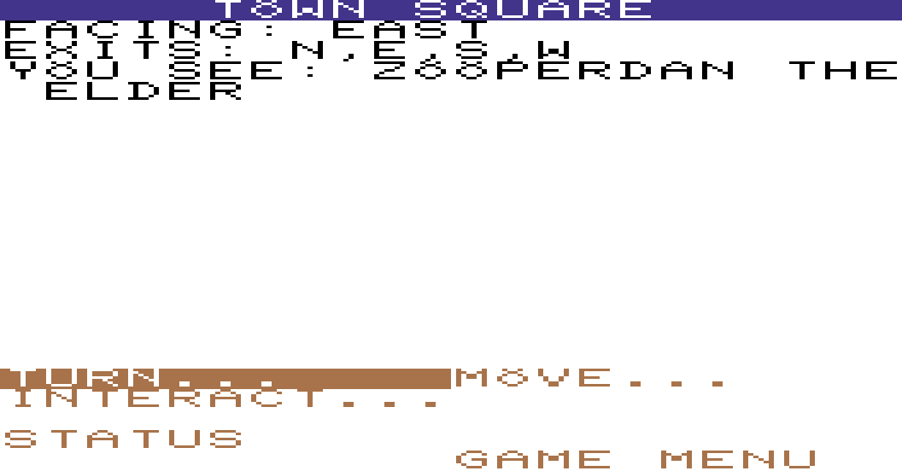
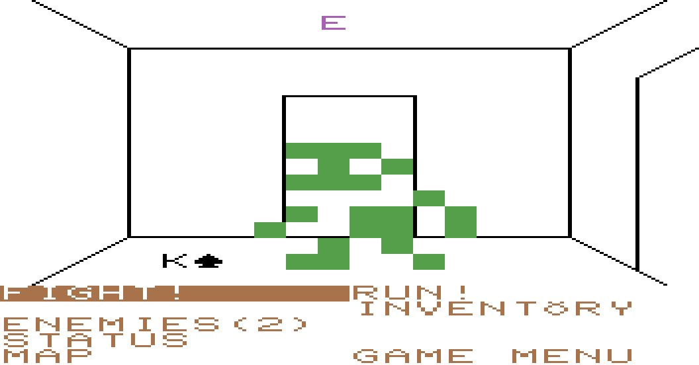
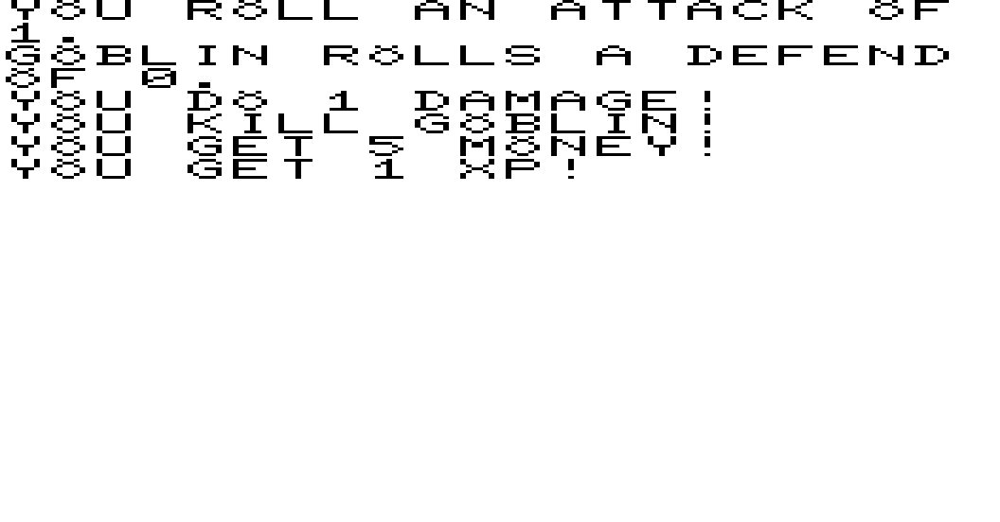

# Kordanor's Cabal runs in your browser now

Kordanor's Cabal is back, and this time it plays right on the page.

I wrote it on stream in 2022 as a VB.NET game, shipped Windows and Linux builds, and then wandered off. The dungeon and the town worked; the story never got finished. This month I rewrote it in Odin, compiled to WebAssembly, so there is nothing to download.

## What it is

A menu-driven dungeon crawler in the look of a VIC-20. You are a n00b hired by the town of Zooperdan to deal with the Cabal of Kordanor, which has set up in the old church. Under the church are five maze levels, each with a boss.

Combat is dice, and only sixes count. That makes gear far more important than levels, so the Blacksmith and the Black Mage are worth your money.

## The rewrite

- Written in Odin, with Claude Code doing much of the typing. I made the design calls.
- Every screen of the original was recorded, and the new version is compared against those recordings cell for cell. Fights from the original are reproduced exactly by finding the seed that produces them.
- Worlds come from a seed. The Status page shows yours; "Start with seed..." replays one.
- The picture is now just the game, as large as your window allows, with letterbox bars instead of the VIC-20 border.
- Phones and tablets work in landscape, with an on-screen pad.

## What is not done

- Most of the lore notes are placeholders.
- The Elemental Orb that opens the last boss is never made, so Kordanor cannot be reached yet.
- The ending is still to be written.

Play it on the page, and tell me where it is too hard.
